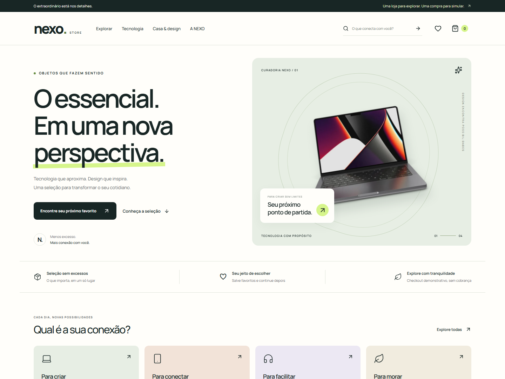
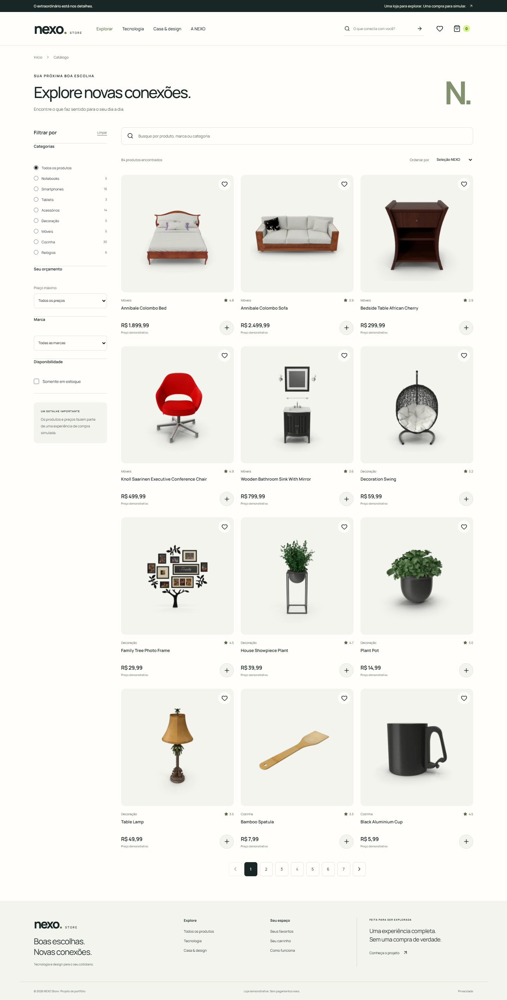
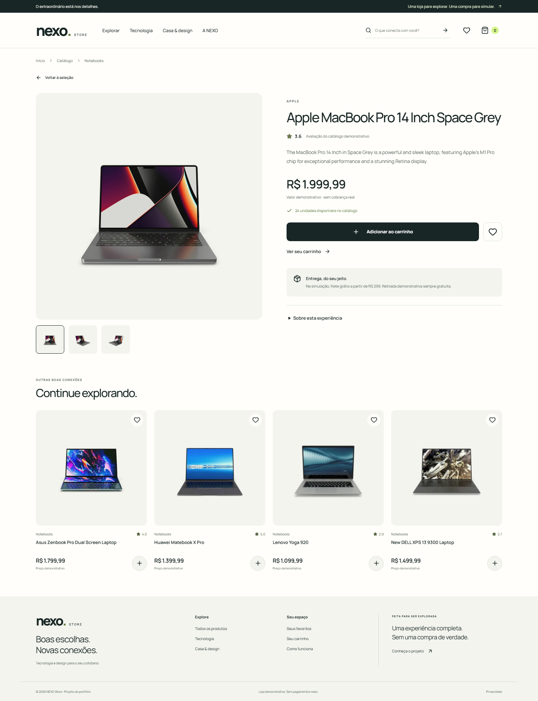
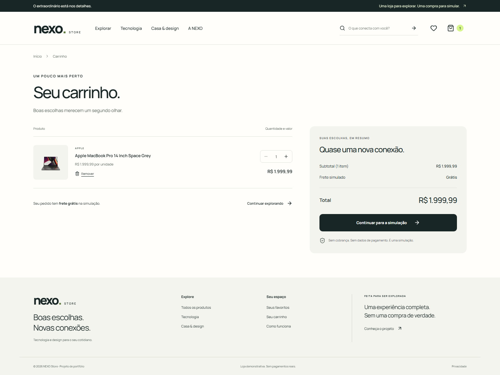
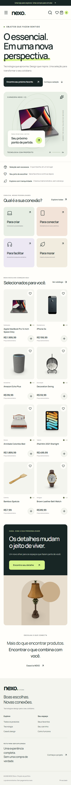

# NEXO Store

**E-commerce front-end de tecnologia e casa, com identidade própria e uma jornada de compra completa.**

[Abrir demonstração](https://alefkaue.github.io/nexo-store/) · [Validações e deploy](https://github.com/alefkaue/nexo-store/actions/workflows/quality-pages.yml) · [Decisões técnicas](docs/ARCHITECTURE.md)



A NEXO combina uma curadoria de produtos com pesquisa, filtros compartilháveis, favoritos, carrinho persistente e checkout demonstrativo. O foco é exercitar o trabalho de front-end de uma loja: estados consistentes, integração REST, acessibilidade, responsividade e regras de negócio testáveis.

Projeto pessoal de portfólio de **Alef Kaue Santos Nunes**, desenvolvido com assistência de IA e revisão por testes e execução no navegador. Sem vínculo comercial com as marcas do catálogo.

## Experimente em dois minutos

1. Explore uma categoria na home ou pesquise por **Apple** no catálogo.
2. Combine categoria, marca, preço máximo e disponibilidade. Ordene e navegue entre páginas.
3. Abra um produto, alterne as imagens e salve nos favoritos.
4. Adicione ao carrinho, altere a quantidade e recarregue: suas escolhas continuam lá.
5. Conclua o checkout usando **Nexo Demo**, **demo@example.com** e **Cidade Exemplo**.

**Não há pagamentos, pedidos, entregas nem reservas reais. Use somente dados fictícios.** O formulário é validado no navegador e descartado; não é enviado à DummyJSON nem persistido.

## Funcionalidades

- Home editorial com banners, categorias, seleção de produtos e chamadas funcionais.
- Catálogo com pesquisa sem distinção de acentos, filtros combinados, cinco ordenações e paginação.
- Filtros na URL, preservados ao recarregar e ao usar voltar/avançar do navegador.
- Página de produto com galeria, descrição, avaliação e disponibilidade fornecidas pela API.
- Carrinho com limites de estoque, alteração de quantidades, remoção e cálculo em centavos.
- Favoritos e carrinho em `localStorage`, com validação de dados e tolerância a armazenamento bloqueado.
- Checkout com validação por campo, foco no primeiro erro e nova consulta de preços/estoque antes da confirmação.
- Tratamento de API indisponível, conexão interrompida, carregamento, produto inexistente, dados inválidos e listas vazias.
- Interface responsiva, menus e filtros mobile com diálogo nativo, teclado, retorno de foco e Escape.
- Textos de demonstração e privacidade disponíveis na página **A NEXO**.

## Stack

| Camada            | Tecnologias                                               |
| ----------------- | --------------------------------------------------------- |
| Interface         | React 19, TypeScript, HTML5 semântico                     |
| Estilos           | SCSS/SASS, tokens de design, Manrope hospedada localmente |
| Navegação         | React Router 7, rotas carregadas sob demanda              |
| Integração        | Fetch API, REST, AbortController, DummyJSON               |
| Build e qualidade | Vite 8, ESLint, Prettier, TypeScript strict               |
| Testes            | Vitest, Testing Library, Playwright, axe-core             |
| Entrega           | Git, GitHub Actions, GitHub Pages                         |

JavaScript moderno também é usado nos scripts de captura e verificação da demonstração. As versões exatas estão fixadas em `package.json` e `package-lock.json`.

## Executar localmente

Requer **Node.js 24 LTS** e npm. O catálogo precisa de acesso à internet; não há chave de API, `.env` obrigatório ou backend próprio.

```bash
git clone https://github.com/alefkaue/nexo-store.git
cd nexo-store
npm ci
npm run dev
```

Abra o endereço informado pelo Vite, normalmente `http://127.0.0.1:5173`.

```bash
npm run build
npm run preview
```

## Qualidade e testes

```bash
npm run format:check
npm run lint
npm run typecheck
npm run test:coverage
npx playwright install chromium
npm run test:e2e
```

Em Linux/CI, use `npx playwright install --with-deps chromium` para instalar também as bibliotecas do navegador.

- **47 testes unitários e de componentes**: cálculos, reducer, filtros, validação, persistência e contrato da API.
- **28 execuções E2E**: 14 cenários em Chromium desktop e Chromium com emulação mobile.
- Axe integrado aos testes em home, catálogo, produto, carrinho e checkout, com regras WCAG 2 A/AA e 2.1 AA. Esse recorte automatizado não equivale a uma certificação de acessibilidade.
- Cobertura com limites mínimos para **domínio, serviço REST e persistência**; não representa a cobertura de toda a interface.

Os E2E usam fixtures e imagens locais interceptadas para testar falhas de forma reproduzível. A aplicação publicada usa **somente a API real**, sem catálogo fictício de fallback. As capturas deste README também usam os dados e imagens reais da API.

Para verificar o fluxo completo com a API real, mantenha o servidor local na porta 4173 e execute:

```bash
npm run dev -- --port 4173
# Em outro terminal:
npm run smoke
npm run screenshots
```

`SMOKE_URL` permite verificar outro endereço. Exemplo em PowerShell:

```powershell
$env:SMOKE_URL = 'https://alefkaue.github.io/nexo-store/'
npm run smoke
```

O comando de smoke consulta a API real, conclui apenas uma simulação com dados fictícios e verifica persistência, fontes, navegação direta, ausência de escritas HTTP e erros JavaScript. `CAPTURE_URL` permite usar outro endereço nas capturas.

## Arquitetura

```text
src/
  app/          Rotas, providers e limite de erros
  components/   Componentes visuais reutilizáveis
  domain/       Tipos e regras puras: catálogo, carrinho e checkout
  hooks/        Metadados por página
  pages/        Telas e composição dos fluxos
  services/     HTTP, timeout e validação do contrato externo
  state/        Estado de catálogo e escolhas; persistência versionada
  styles/       Tokens, mixins SASS e estilos responsivos
tests/
  e2e/          Fluxos de navegador e acessibilidade
  fixtures/     Dados exclusivos dos testes
scripts/        Capturas reais e smoke de integração
```

O estado remoto do catálogo é separado do carrinho/favoritos. Regras de negócio não dependem dos componentes. Context e reducer atendem ao tamanho do projeto sem adicionar um gerenciador de estado externo. [Detalhes e limites da solução](docs/ARCHITECTURE.md).

## API e regras da demonstração

A integração utiliza os endpoints oficiais da [DummyJSON Products](https://dummyjson.com/docs/products):

```text
GET /products?limit=0&select=id,title,description,category,price,stock,rating,thumbnail,images,brand
GET /products/:id
```

O catálogo apresenta oito categorias de tecnologia e casa. A busca e os filtros são aplicados em memória após a consulta, para permitir combinações que a API não oferece em um único endpoint. Essa escolha é adequada ao conjunto pequeno da demonstração; uma loja de produção precisaria de paginação e busca no servidor.

- Os valores da API são usados como **preços fictícios em reais, sem conversão cambial**.
- Frete fictício: R$ 19,90 abaixo de R$ 299; gratuito a partir desse valor. Retirada demonstrativa gratuita.
- Até 30 produtos diferentes, 99 unidades por produto e 100 favoritos; o estoque pode impor limite menor.
- Se preço, estoque ou disponibilidade mudarem na revalidação, o checkout pede revisão e preserva o carrinho.
- O storage guarda somente IDs e quantidades. Bloqueá-lo mantém a sessão utilizável, com aviso.
- A confirmação não cria pedidos na DummyJSON. Não há cadastro, CPF, cartão ou endereço completo.

## Design, acessibilidade e performance

A identidade usa branco quente, verde escuro, lima e superfícies suaves. Tipografia, espaços e cores estão centralizados em [`_tokens.scss`](src/styles/_tokens.scss). Componentes usam nomenclatura BEM e mixins SASS. Não foi usado template de loja ou biblioteca de componentes pronta.

Há imagens com dimensões reservadas e carregamento sob demanda, assets editoriais WebP, fonte local, divisão de código por rota, `prefers-reduced-motion`, labels explícitos, link de pular conteúdo e avisos anunciados por leitores de tela. Títulos, descrições e canonical são atualizados por rota.

É uma **SPA renderizada no cliente**: robôs e previews sociais sem JavaScript não recebem metadados exclusivos de cada produto. Renderização no servidor/pré-renderização seria o próximo passo para SEO comercial. Não há pontuação Lighthouse ou aprovação WCAG integral presumida.

## Capturas reais

<details>
<summary>Catálogo, produto, carrinho e home mobile</summary>

### Catálogo



### Produto



### Carrinho



### Mobile



</details>

Capturas geradas pelo Playwright, sem montagem ou mock visual. O roteiro está em `scripts/capture.mjs`.

## Deploy

O workflow [`quality-pages.yml`](.github/workflows/quality-pages.yml) executa formatação, lint, tipagem, cobertura, auditoria de dependências, E2E e build. O deploy depende da aprovação dessas etapas. As Actions estão fixadas por SHA e somente o job de deploy recebe permissão de publicar no Pages.

Em `main`, o build usa `BASE_PATH=/nexo-store/`. O `404.html` restaura rotas diretas do React Router no Pages, inclusive query string. A primeira resposta HTTP de uma rota profunda é 404 antes do redirecionamento para a SPA: essa limitação do hosting estático afeta SEO e não equivale a SSR.

Para outro nome de repositório, ajuste o caminho no workflow e em `public/404.html`. Para Vercel, o `vercel.json` oferece rewrite para a SPA; deixe `BASE_PATH` sem valor para publicar na raiz. A demonstração principal usa GitHub Pages.

## Autoria e licenças

[Alef Kaue Santos Nunes](https://github.com/alefkaue) — técnico em Desenvolvimento de Sistemas e estudante de Segurança Cibernética no SENAI.

Código sob [licença MIT](LICENSE). Imagens e marcas do catálogo permanecem de seus titulares; consulte [créditos dos assets](public/assets/CREDITS.md). Fonte Manrope sob [SIL Open Font License](public/fonts/OFL.txt).

Referências: [DummyJSON](https://dummyjson.com/docs/products), [React](https://react.dev/), [React Router](https://reactrouter.com/), [Vite](https://vite.dev/guide/), [Vitest](https://vitest.dev/guide/), [Playwright](https://playwright.dev/docs/intro), [axe-core](https://github.com/dequelabs/axe-core) e [GitHub Pages](https://docs.github.com/en/pages/getting-started-with-github-pages/using-custom-workflows-with-github-pages).
