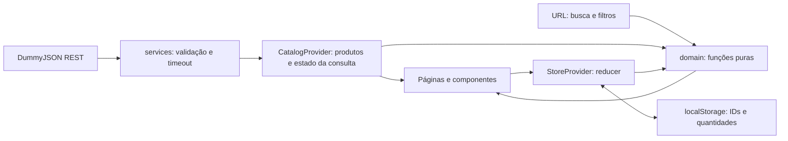

# Decisões técnicas

## Responsabilidades



`domain` contém regras independentes de React. `services` transforma dados externos `unknown` em produtos tipados; TypeScript sozinho não valida JSON em runtime. Providers coordenam estado e efeitos. Páginas compõem componentes e tratam as interações.

## Estado remoto e concorrência

`CatalogProvider` consulta o catálogo uma vez por montagem e permite recarregar na revalidação. Requisições antigas não substituem o resultado de uma chamada mais recente. AbortController cancela a montagem e limita chamadas a 12 segundos. Não existe cache offline fingindo que a API continua atualizada.

O detalhe usa o endpoint individual e cancela a requisição ao trocar de produto. A galeria volta à primeira imagem. URLs de imagem externas são aceitas somente por HTTPS no CDN da DummyJSON; imagens ausentes/indisponíveis recebem placeholder local.

## Busca, filtros e URL

`q`, `categoria`, `colecao`, `marca`, `max`, `estoque`, `ordem` e `page` são o estado compartilhável do catálogo. Não é necessário sincronizar um segundo estado global de filtros. Mudanças de filtro reiniciam a página; trocar categoria também limpa marca e coleção. A função de paginação limita páginas inválidas ao intervalo existente.

O Router usa `useTransitions={false}` porque inputs controlados são derivados diretamente da URL. Assim, o evento de alteração atualiza imediatamente o estado do campo. Isso evita o retorno transitório ao valor anterior. A escolha segue a [opção oficial de transições do React Router](https://reactrouter.com/explanation/react-transitions); uma alternativa para catálogos maiores seria manter estado local urgente e aplicar a busca com debounce.

A API é carregada por inteiro com seleção de campos e limite defensivo de 2.000 registros. As oito categorias são uma curadoria explícita, sem alterar os produtos. A filtragem em memória simplifica combinações; não é uma recomendação para milhões de SKUs.

## Carrinho e valores

O reducer aceita operações explícitas de adicionar, remover, alterar quantidade, favoritar e limpar carrinho. Valores monetários são arredondados para centavos antes das somas. Não se usa `preço * quantidade` em floats para exibir o total final.

Produtos removidos da API continuam removíveis no carrinho. Estoque insuficiente bloqueia o checkout e aparece na linha afetada. Limites de quantidade/tamanho também se aplicam a dados recuperados do storage.

## Persistência e privacidade

Chave `nexo:store:v1`, payload versionado. Apenas IDs inteiros positivos e quantidades limitadas são aceitos; JSON corrompido e versões desconhecidas voltam ao estado vazio. Duplicatas são tratadas, e o navegador pode bloquear storage sem quebrar a sessão.

Não há sincronização entre abas/janelas, autenticação ou carrinho de servidor. O formulário do checkout existe apenas no estado do componente, sem envio ou persistência. O histórico de navegação recebe somente referência aleatória, contagem e total da simulação. Não há analytics nem scripts publicitários.

## Checkout

```mermaid
sequenceDiagram
  participant U as Usuário
  participant F as Formulário local
  participant A as DummyJSON
  participant R as Regras de carrinho
  U->>F: Dados fictícios e concordância
  F->>F: Validação e foco no primeiro erro
  F->>A: GET produtos, sem dados do formulário
  A-->>F: Catálogo atualizado
  F->>R: Comparar preço/estoque e recalcular
  alt Houve mudança ou erro
    F-->>U: Solicitar revisão; preservar carrinho
  else Consulta consistente
    F-->>U: Confirmação demonstrativa
    F->>F: Limpar carrinho; preservar favoritos
  end
```

Um lock impede confirmação duplicada durante a consulta. A revalidação reduz divergências na demonstração, mas não é uma transação/reserva atômica. Uma loja real exigiria backend, estoque transacional, cálculo de preço no servidor e provedor de pagamento.

## Design System

- Tokens SASS: cores, espaçamentos, raio, mixins de foco e breakpoints.
- Primitivos: botão, link, imagem com fallback, quantidade, estado vazio, erro, skeleton e diálogo.
- Compostos: ProductCard, Filters e OrderSummary.
- SCSS com BEM, grid/flex, breakpoints de 1020/780/390 px e preferência de movimento reduzido.
- Manrope local com fallback Arial; imagens editoriais em WebP. Ícones Lucide com nome acessível no controle, sem leitura redundante do SVG.

## Testes e limites

Unitários testam invariantes, validação, filtros, serialização e HTTP. E2E verificam interações em dois tamanhos de tela com dados controlados; o produto 999 é um caso sintético esgotado exclusivo dos testes. `smoke.mjs` verifica a integração real, enquanto `capture.mjs` produz imagens reais para a documentação.

O ambiente mobile dos testes é emulação Chromium, não um aparelho físico ou teste em Safari. Axe cobre cinco páginas; ainda são relevantes revisão com leitores de tela, testes manuais de zoom e testes em outros motores. Metadados são atualizados no cliente; não existe SSR, checkout real ou promessa de operação comercial.
